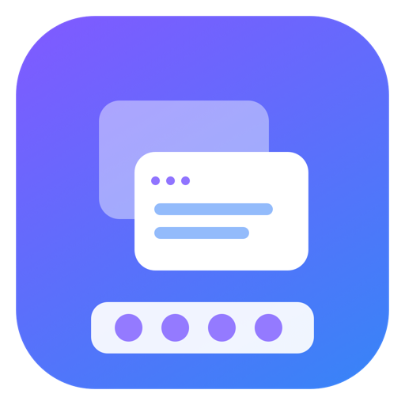
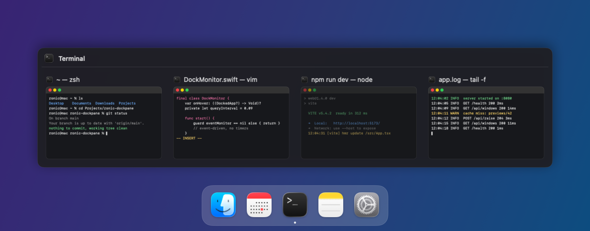
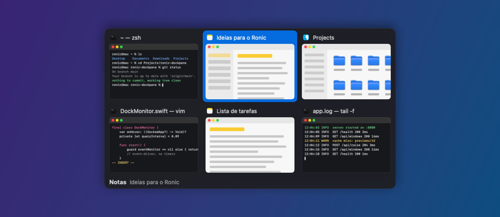

<p align="center">
  
</p>

<h1 align="center">Ronic DockPane</h1>

<p align="center">
  <b>Hover an app in the Dock and see a live preview of each open window, like the Windows taskbar, then jump straight to one. Or press ⌥Tab to switch between windows, like Alt+Tab.</b><br>
  Native Swift · no third-party dependencies · menu bar only
</p>

<p align="center">
  <a href="https://github.com/jhowmael/Ronic-DockPane/releases/latest/download/RonicDockPane.dmg">
    
  </a>
</p>

<p align="center">
  <a href="https://github.com/jhowmael/Ronic-DockPane/releases">All releases</a> ·
  <a href="#installation">Installation</a> ·
  <a href="#window-switcher-tab">⌥Tab switcher</a> ·
  <a href="#how-it-works">How it works</a> ·
  <a href="#building">Build</a>
</p>

<p align="center">
  
</p>

---

## Download

| System | File | Requirements |
|---|---|---|
| **macOS** (Apple Silicon and Intel) | [`RonicDockPane.dmg`](https://github.com/jhowmael/Ronic-DockPane/releases/latest/download/RonicDockPane.dmg) (installer) · [`.zip`](https://github.com/jhowmael/Ronic-DockPane/releases/latest/download/RonicDockPane-macOS.zip) | macOS 13 Ventura or later |

* **Menu bar only.** No icon in the Dock and no app menu.
* **Permissions:** Accessibility is required. Screen Recording turns on the thumbnails; until you grant it, each card shows the app icon and the panel offers a button to enable previews.
* **Idle cost is minimal.** There are no timers and no polling. The mouse is watched through an event monitor, and the Dock is queried only while the pointer is on the Dock's edge.

## Installation

1. Download `RonicDockPane.dmg`, open it, and drag **RonicDockPane** onto the **Applications** shortcut. (Or download the `.zip`, unzip it, and move the app to **Applications**.)
2. Open the app. The first time, macOS may block it: go to **System Settings › Privacy & Security** and click **Open Anyway**. From the Terminal: `xattr -dr com.apple.quarantine /Applications/RonicDockPane.app`.
3. Grant **Accessibility**: in **System Settings › Privacy & Security › Accessibility**, turn on **Ronic DockPane**. Ronic DockPane shows an alert that opens that pane for you.
4. Optional: turn on **Screen Recording** for window previews. Ronic DockPane asks once and opens the pane for you. In **System Settings › Privacy & Security › Screen & System Audio Recording**, turn on **Ronic DockPane**, then choose **Already enabled: relaunch** (*Já ativei: reabrir o app*) in the menu, because macOS only applies the permission to a fresh launch.
5. Done. The Ronic "R" appears in the menu bar. Hover any running app in the Dock.

> **Permission on but Ronic DockPane still says it's not granted?** Each new build is a new app for macOS. Turn the toggle off and on, or remove Ronic DockPane from the list with **−** and open it again.

### Menu bar

| Item | What it does |
|---|---|
| **Accessibility** status | Shows whether the permission is granted. **Grant permission…** appears when it isn't. |
| **Window previews** | Shows whether thumbnails are on. **Enable previews…** opens the Screen Recording pane; **Already enabled: relaunch** restarts the app to apply it. Needs macOS 14 or later. |
| **Window switcher (⌥Tab)** (*Alternador de janelas*) | Turns the ⌥Tab window switcher on or off. On by default. |
| **Launch at login** (*Iniciar com o macOS*) | Adds or removes Ronic DockPane from the system's login items (`SMAppService`). |
| **Quit** (*Sair*) | Quits Ronic DockPane. |

## Window switcher (⌥Tab)

<p align="center">
  
</p>

The ⌘Tab built into macOS switches between **apps**. ⌥Tab in Ronic DockPane switches between **windows**, like Alt+Tab on Windows. It shows every window of every app as a card with its thumbnail, the most recently used first.

| Keys | What they do |
|---|---|
| Hold **⌥** and press **Tab** | Opens the switcher and moves to the next window. Keep pressing Tab to go further. |
| **⌥⇧Tab**, **← → ↑ ↓** | Move backwards, or around the grid. |
| Let go of **⌥** | Switches to the selected window (unminimizing it if needed). |
| **Esc** | Cancels. |
| A quick **⌥Tab** tap | Jumps straight back to the previous window, without showing the panel. |

You can also click a card, or close a window with its ✕. Turn the switcher off in the menu bar menu.

**With Ronic MacToWindows:** its Alt+Tab (for apps) also uses ⌥Tab. While this switcher is on, MacToWindows steps aside automatically and gets the shortcut back when Ronic DockPane quits or the switcher is turned off. The two apps coordinate through a system notification ([ADR 0002](docs/adr/0002-alternador-de-janelas-com-option-tab.md)). To use another key with ⌥ instead of Tab, run `defaults write io.github.jhowmael.ronicdockpane switcherKeyCode -int 50` (50 is the key to the left of 1) and relaunch.

## How it works

1. A global `mouseMoved` monitor watches the pointer. Nothing else runs while it stays away from the Dock.
2. When the pointer enters the strip along the Dock's edge (bottom, left or right, read from the Dock's settings), Ronic DockPane asks the Accessibility API which Dock icon is under it. At most one query runs every 50 ms, off the main thread, on its own queue.
3. The icon is matched to a running app, and its windows are read through `kAXWindowsAttribute`. Only standard windows with a title are kept, and minimized windows are included. When the pointer reaches the Dock, the window lists of all apps are read in parallel, so hovering an icon shows its panel at once; the list is refreshed in the background on every hover.
4. A floating panel fades in above the icon, with the app name the Dock shows fitting in between, never over the panel. Each card shows its window title above the thumbnail (the full title on hover). With Dock magnification on, the panel is placed for the fully magnified icon, so a growing icon never runs into it. It doesn't take focus from the app you're using. Moving to another icon glides the panel there in 0.14 s, quick at the start so it keeps up with the pointer.
5. With Screen Recording granted, a thumbnail of each window is captured with ScreenCaptureKit (one still image per window, only while the panel is open). The panel appears immediately with placeholders and the thumbnails fill in as they arrive. On macOS 13 the panel shows a plain list of titles instead.
6. Hovering a card shows a red ✕ that closes that window for real (it presses the window's own close button, so the app may still ask to save). Clicking a window unminimizes it if needed, raises it, activates its app, and closes the panel. The panel also closes about 250 ms after the pointer leaves both the icon and the panel, which gives you time to move between them. It then shrinks smoothly into the Dock icon, as if pulled in; a window closed with ✕ goes the same way. With **Reduce motion** on, both just fade.
7. **⌥Tab** goes through a keyboard event tap (it needs the same Accessibility permission). The windows of every app are ordered by how they are stacked on screen, which is the order you last used them.

## Settings

The minimum number of windows is set in `Sources/DockPane/DockPaneApp.swift`:

```swift
private let panel = FloatingPanelController(minimumWindows: 0)
```

With `0`, an app that is still running with no windows (you closed them with the red button) shows a card: click it to open a new window, or use ✕ to quit the app. Set it to `1` to skip those apps, or `2` to show the panel only for apps with several windows.

## Privacy

* Thumbnails are the only thing that uses **Screen Recording**, and that permission is optional. Each thumbnail is a single still image of one window. The last one of each open window stays in memory, so the panel and the switcher open with images straight away; it is discarded when the window closes or the app quits.
* The ⌥Tab switcher uses a keyboard event tap, which sees every key press. It only reacts to ⌥Tab and, while the switcher is open, to the arrow keys, Esc and Enter. Every other key passes through untouched, and no key is ever stored or logged.
* Nothing is recorded, saved to disk, or sent anywhere. The reasoning is in [ADR 0001](docs/adr/0001-previa-de-janelas-com-gravacao-de-tela.md).
* Apart from that, it makes no network connections and writes no files, except the optional login item.
* Window titles stay in memory and are never stored or sent anywhere.

## Building

Requires macOS 13+ and Xcode 15 or later (or only the Command Line Tools, for `make dev` and `make app`).

### In Xcode

1. Open Xcode, then **File ▸ Open…** and select **`Package.swift`** in this folder. Xcode opens the package as a project.
2. Choose the **DockPane** scheme and the **My Mac** destination.
3. Select the **DockPane** target, open **Signing & Capabilities**, and pick your team (or **Sign to Run Locally**).
4. **App Sandbox:** this package doesn't enable it, so nothing needs changing. If you move the code into an Xcode *App* target, remove the **App Sandbox** capability (the trash icon in *Signing & Capabilities*). The Accessibility APIs don't work from a sandboxed app.
5. **Info.plist:** `LSUIElement` is already `YES` in `Resources/Info.plist`. Running from Xcode launches the bare binary, so the app also sets the accessory activation policy in code and stays out of the Dock. **Launch at login** works only from the packaged `.app` in `/Applications`.
6. Press **⌘R**. When the alert appears, grant Accessibility, then bring Ronic DockPane to the front again (for example, click its menu bar icon).

### From the Terminal

```bash
make dev          # run with 'swift run'
make app          # dist/RonicDockPane.app + .zip + .dmg installer
make universal    # universal binary (requires full Xcode)
make icons        # regenerate the logo and AppIcon.icns
make screenshots  # re-render docs/preview.png and docs/switcher.png
```

`scripts/package-macos.sh` signs the app with a local certificate (`scripts/dev-signing.sh`), so the Accessibility permission survives rebuilds. On CI it uses ad-hoc signing.

## Project layout

```
Package.swift                              SwiftPM package (opens in Xcode)
Resources/Info.plist                       LSUIElement = YES (menu bar only)
Resources/AppIcon.icns                     app icon
Sources/DockPane/
  DockPaneApp.swift                        MenuBarExtra, launch at login, app delegate
  DockMonitor.swift                        global mouse monitor, throttled Dock hit tests
  AccessibilityHelper.swift                AX: trust, Dock items, windows, raise
  FloatingPanelController.swift            NSPanel (nonactivating), positioning, animations, close delay
  WindowListView.swift                     SwiftUI thumbnail cards (or plain list) with hover highlight
  WindowPreviewProvider.swift              ScreenCaptureKit thumbnails, matched to AX windows, memory cache
  WindowSwitcher.swift                     ⌥Tab: event tap, window order, switcher panel
  GenieEffect.swift                        close animation into the Dock icon
docs/adr/                                  architecture decision records
branding/                                  logo and icon generators
scripts/                                   packaging and signing
.github/workflows/release.yml              builds the .zip and publishes it on "v*" tags
```
